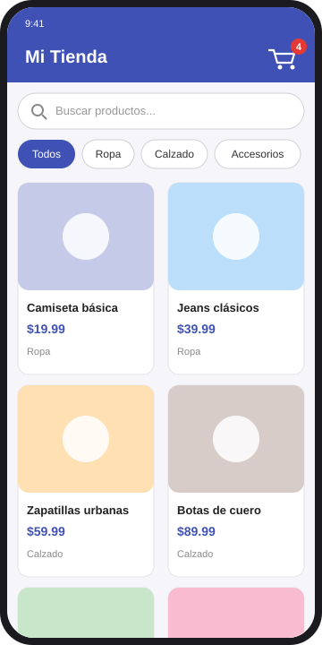
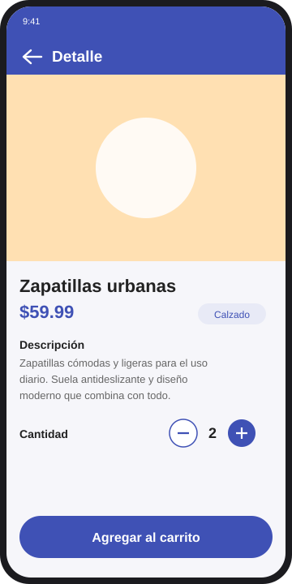
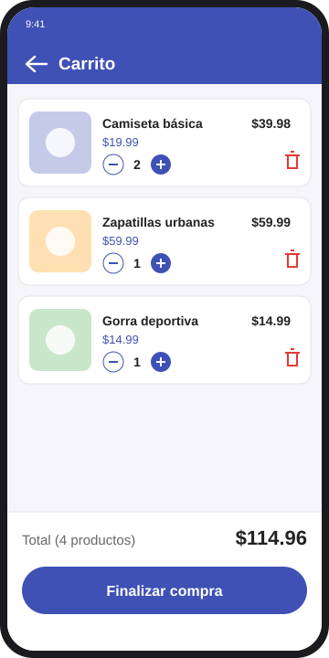
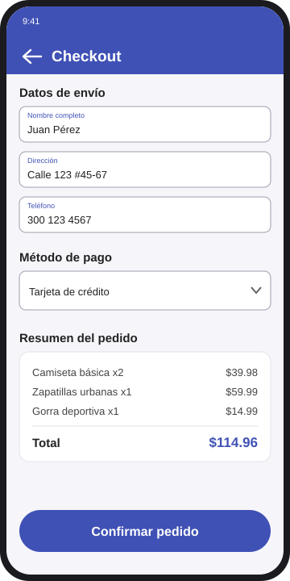
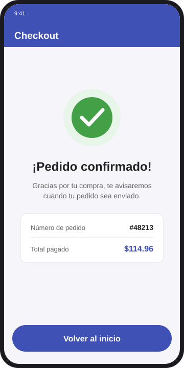

# Guía paso a paso: E-commerce sencillo en Flutter

**Centro Tecnológico Francisco "El Chele" Moreno**
**Nombre del curso:** Desarrollo Frontend multiplataforma con Flutter
**Docente:** Hanssell José Cerda Woo

---

Aprenderás a construir una tienda en línea básica con **4 pantallas**, navegación con **rutas nombradas del `Navigator` nativo de Flutter** (sin paquetes externos) y manejo de estado con **Provider**.

| #   | Pantalla                | Ruta                                     |
| --- | ----------------------- | ---------------------------------------- |
| 1   | Inicio / Catálogo       | `/`                                      |
| 2   | Detalle del producto    | `/detalle` (recibe el id como argumento) |
| 3   | Carrito                 | `/carrito`                               |
| 4   | Checkout + confirmación | `/checkout`                              |

**Flujo:** Catálogo → Detalle → Carrito → Checkout

> **Nota:** las imágenes de esta guía son maquetas de referencia de cómo debe verse cada pantalla al final. Tu resultado puede variar levemente según la versión de Flutter y el dispositivo.

---

## Paso 0. Requisitos

- Flutter SDK 3.19 o superior (`flutter --version`).
- Un editor (VS Code o Android Studio) con el plugin de Flutter.
- Un emulador, un dispositivo físico o Chrome para probar.

Verifica tu instalación:

```bash
flutter doctor
```

## Paso 1. Crear el proyecto

```bash
flutter create ecommerce_simple
cd ecommerce_simple
```

## Paso 2. Agregar dependencias

```bash
flutter pub add provider
```

Tu `pubspec.yaml` debe incluir algo similar a:

```yaml
dependencies:
  flutter:
    sdk: flutter
  provider: ^6.1.2
```

## Paso 3. Estructura de carpetas

Dentro de `lib/` crea esta estructura:

```
lib/
├── main.dart
├── routes/
│   └── app_routes.dart
├── models/
│   ├── product.dart
│   └── cart_item.dart
├── data/
│   └── products_data.dart
├── providers/
│   ├── catalog_provider.dart
│   └── cart_provider.dart
├── screens/
│   ├── home_screen.dart
│   ├── product_detail_screen.dart
│   ├── cart_screen.dart
│   └── checkout_screen.dart
└── widgets/
    └── product_card.dart
```

> Para no usar imágenes de internet (y que todo funcione sin conexión), cada producto usa un **icono y un color** como imagen. Más adelante puedes cambiarlo por `Image.network`.

---

## Paso 4. Modelos y datos

### `lib/models/product.dart`

```dart
import 'package:flutter/material.dart';

class Product {
  final int id;
  final String name;
  final String description;
  final double price;
  final String category;
  final IconData icon;
  final Color color;

  const Product({
    required this.id,
    required this.name,
    required this.description,
    required this.price,
    required this.category,
    required this.icon,
    required this.color,
  });
}
```

### `lib/models/cart_item.dart`

```dart
import 'product.dart';

class CartItem {
  final Product product;
  int quantity;

  CartItem({required this.product, this.quantity = 1});

  double get subtotal => product.price * quantity;
}
```

### `lib/data/products_data.dart`

```dart
import 'package:flutter/material.dart';
import '../models/product.dart';

final List<Product> productsData = [
  Product(
    id: 1,
    name: 'Camiseta básica',
    description: 'Camiseta de algodón suave y cómoda, ideal para todos los días.',
    price: 19.99,
    category: 'Ropa',
    icon: Icons.checkroom,
    color: Colors.indigo.shade100,
  ),
  Product(
    id: 2,
    name: 'Jeans clásicos',
    description: 'Jeans de corte recto, resistentes y con excelente ajuste.',
    price: 39.99,
    category: 'Ropa',
    icon: Icons.style,
    color: Colors.blue.shade100,
  ),
  Product(
    id: 3,
    name: 'Zapatillas urbanas',
    description:
        'Zapatillas cómodas y ligeras para el uso diario. Suela antideslizante y diseño moderno que combina con todo.',
    price: 59.99,
    category: 'Calzado',
    icon: Icons.directions_run,
    color: Colors.orange.shade100,
  ),
  Product(
    id: 4,
    name: 'Botas de cuero',
    description: 'Botas de cuero resistentes, perfectas para clima frío o lluvia.',
    price: 89.99,
    category: 'Calzado',
    icon: Icons.hiking,
    color: Colors.brown.shade100,
  ),
  Product(
    id: 5,
    name: 'Gorra deportiva',
    description: 'Gorra ajustable y transpirable para actividades al aire libre.',
    price: 14.99,
    category: 'Accesorios',
    icon: Icons.sports_baseball,
    color: Colors.green.shade100,
  ),
  Product(
    id: 6,
    name: 'Mochila urbana',
    description: 'Mochila con compartimento para laptop y múltiples bolsillos.',
    price: 34.99,
    category: 'Accesorios',
    icon: Icons.backpack,
    color: Colors.pink.shade100,
  ),
];
```

---

## Paso 5. Providers (estado de la app)

Usaremos dos providers:

- **CatalogProvider**: guarda la búsqueda y la categoría seleccionada, y entrega la lista filtrada.
- **CartProvider**: administra los productos del carrito.

### `lib/providers/catalog_provider.dart`

```dart
import 'package:flutter/foundation.dart';
import '../data/products_data.dart';
import '../models/product.dart';

class CatalogProvider extends ChangeNotifier {
  String _query = '';
  String _category = 'Todos';

  String get category => _category;

  List<String> get categories =>
      ['Todos', ...productsData.map((p) => p.category).toSet()];

  List<Product> get products {
    return productsData.where((p) {
      final matchesCategory = _category == 'Todos' || p.category == _category;
      final matchesQuery =
          p.name.toLowerCase().contains(_query.toLowerCase());
      return matchesCategory && matchesQuery;
    }).toList();
  }

  Product? findById(int id) {
    for (final p in productsData) {
      if (p.id == id) return p;
    }
    return null;
  }

  void setQuery(String value) {
    _query = value;
    notifyListeners();
  }

  void setCategory(String value) {
    _category = value;
    notifyListeners();
  }
}
```

### `lib/providers/cart_provider.dart`

```dart
import 'package:flutter/foundation.dart';
import '../models/cart_item.dart';
import '../models/product.dart';

class CartProvider extends ChangeNotifier {
  final Map<int, CartItem> _items = {};

  List<CartItem> get items => _items.values.toList();

  bool get isEmpty => _items.isEmpty;

  /// Total de unidades (se muestra en el badge del carrito).
  int get totalCount =>
      _items.values.fold(0, (sum, item) => sum + item.quantity);

  double get total =>
      _items.values.fold(0.0, (sum, item) => sum + item.subtotal);

  void add(Product product, {int quantity = 1}) {
    if (_items.containsKey(product.id)) {
      _items[product.id]!.quantity += quantity;
    } else {
      _items[product.id] = CartItem(product: product, quantity: quantity);
    }
    notifyListeners();
  }

  void increment(int productId) {
    _items[productId]?.quantity++;
    notifyListeners();
  }

  void decrement(int productId) {
    final item = _items[productId];
    if (item == null) return;
    if (item.quantity > 1) {
      item.quantity--;
    } else {
      _items.remove(productId);
    }
    notifyListeners();
  }

  void remove(int productId) {
    _items.remove(productId);
    notifyListeners();
  }

  void clear() {
    _items.clear();
    notifyListeners();
  }
}
```

---

## Paso 6. Sistema de rutas con el Navigator nativo

Usamos **rutas nombradas** del `Navigator` de Flutter. Todas las rutas se centralizan en una sola clase `AppRoutes`, que tiene los nombres y un mapa `routes`. Ese mapa se entrega a `MaterialApp`.

### `lib/routes/app_routes.dart`

```dart
import 'package:flutter/material.dart';
import '../screens/cart_screen.dart';
import '../screens/checkout_screen.dart';
import '../screens/home_screen.dart';
import '../screens/product_detail_screen.dart';

class AppRoutes {
  // Nombres de las rutas
  static const String home = '/';
  static const String detail = '/detalle';
  static const String cart = '/carrito';
  static const String checkout = '/checkout';

  // Mapa de rutas
  static Map<String, WidgetBuilder> routes = {
    home: (context) => const HomeScreen(),
    detail: (context) => const ProductDetailScreen(),
    cart: (context) => const CartScreen(),
    checkout: (context) => const CheckoutScreen(),
  };
}
```

> `ProductDetailScreen` no recibe el id por constructor: lo lee de los **argumentos de la ruta** (ver Paso 9).

**Cómo navegar desde cualquier pantalla:**

| Acción                                  | Código                                                                         |
| --------------------------------------- | ------------------------------------------------------------------------------ |
| Ir a una pantalla y poder volver atrás  | `Navigator.pushNamed(context, AppRoutes.cart)`                                 |
| Pasar un argumento                      | `Navigator.pushNamed(context, AppRoutes.detail, arguments: 3)`                 |
| Volver a la pantalla anterior           | `Navigator.pop(context)`                                                       |
| Ir a una pantalla y borrar el historial | `Navigator.pushNamedAndRemoveUntil(context, AppRoutes.home, (route) => false)` |

---

## Paso 7. `main.dart`

Registramos los providers con `MultiProvider` por encima de toda la app y dentro de `MaterialApp` indicamos la ruta inicial (`initialRoute`) y el archivo de rutas (`routes`).

### `lib/main.dart`

```dart
import 'package:flutter/material.dart';
import 'package:provider/provider.dart';
import 'providers/cart_provider.dart';
import 'providers/catalog_provider.dart';
import 'routes/app_routes.dart';

void main() {
  runApp(
    MultiProvider(
      providers: [
        ChangeNotifierProvider(create: (_) => CatalogProvider()),
        ChangeNotifierProvider(create: (_) => CartProvider()),
      ],
      child: const MyApp(),
    ),
  );
}

class MyApp extends StatelessWidget {
  const MyApp({super.key});

  @override
  Widget build(BuildContext context) {
    return MaterialApp(
      title: 'Mi Tienda',
      debugShowCheckedModeBanner: false,
      theme: ThemeData(
        useMaterial3: true,
        colorScheme: ColorScheme.fromSeed(seedColor: Colors.indigo),
        appBarTheme: const AppBarTheme(
          backgroundColor: Colors.indigo,
          foregroundColor: Colors.white,
        ),
      ),
      initialRoute: AppRoutes.home, // Pantalla inicial
      routes: AppRoutes.routes, // Solo se llama el archivo de rutas
    );
  }
}
```

---

## Paso 8. Pantalla 1: Inicio / Catálogo

Incluye: AppBar con icono de carrito y contador, buscador, chips de categoría y cuadrícula de productos.



### `lib/widgets/product_card.dart`

```dart
import 'package:flutter/material.dart';
import '../models/product.dart';
import '../routes/app_routes.dart';

class ProductCard extends StatelessWidget {
  final Product product;
  const ProductCard({super.key, required this.product});

  @override
  Widget build(BuildContext context) {
    return Card(
      clipBehavior: Clip.antiAlias,
      elevation: 1,
      child: InkWell(
        onTap: () => Navigator.pushNamed(
          context,
          AppRoutes.detail,
          arguments: product.id,
        ),
        child: Column(
          crossAxisAlignment: CrossAxisAlignment.start,
          children: [
            Expanded(
              child: Container(
                width: double.infinity,
                color: product.color,
                child: Center(
                  child: CircleAvatar(
                    radius: 26,
                    backgroundColor: Colors.white70,
                    child: Icon(product.icon, size: 28, color: Colors.indigo),
                  ),
                ),
              ),
            ),
            Padding(
              padding: const EdgeInsets.all(10),
              child: Column(
                crossAxisAlignment: CrossAxisAlignment.start,
                children: [
                  Text(
                    product.name,
                    maxLines: 1,
                    overflow: TextOverflow.ellipsis,
                    style: const TextStyle(fontWeight: FontWeight.bold),
                  ),
                  const SizedBox(height: 4),
                  Text(
                    '\$${product.price.toStringAsFixed(2)}',
                    style: const TextStyle(
                      color: Colors.indigo,
                      fontWeight: FontWeight.bold,
                    ),
                  ),
                  Text(
                    product.category,
                    style: TextStyle(fontSize: 11, color: Colors.grey.shade600),
                  ),
                ],
              ),
            ),
          ],
        ),
      ),
    );
  }
}
```

### `lib/screens/home_screen.dart`

```dart
import 'package:flutter/material.dart';
import 'package:provider/provider.dart';
import '../providers/cart_provider.dart';
import '../providers/catalog_provider.dart';
import '../routes/app_routes.dart';
import '../widgets/product_card.dart';

class HomeScreen extends StatelessWidget {
  const HomeScreen({super.key});

  @override
  Widget build(BuildContext context) {
    final catalog = context.watch<CatalogProvider>();
    final cart = context.watch<CartProvider>();
    final products = catalog.products;

    return Scaffold(
      appBar: AppBar(
        title: const Text('Mi Tienda',
            style: TextStyle(fontWeight: FontWeight.bold)),
        actions: [
          IconButton(
            onPressed: () => Navigator.pushNamed(context, AppRoutes.cart),
            icon: Badge(
              label: Text('${cart.totalCount}'),
              isLabelVisible: cart.totalCount > 0,
              child: const Icon(Icons.shopping_cart_outlined),
            ),
          ),
          const SizedBox(width: 8),
        ],
      ),
      body: Column(
        children: [
          // Buscador
          Padding(
            padding: const EdgeInsets.fromLTRB(16, 12, 16, 4),
            child: TextField(
              onChanged: context.read<CatalogProvider>().setQuery,
              decoration: InputDecoration(
                hintText: 'Buscar productos...',
                prefixIcon: const Icon(Icons.search),
                filled: true,
                fillColor: Colors.white,
                contentPadding: EdgeInsets.zero,
                border: OutlineInputBorder(
                  borderRadius: BorderRadius.circular(24),
                ),
              ),
            ),
          ),
          // Categorías
          SizedBox(
            height: 52,
            child: ListView(
              scrollDirection: Axis.horizontal,
              padding: const EdgeInsets.symmetric(horizontal: 12),
              children: catalog.categories.map((c) {
                return Padding(
                  padding: const EdgeInsets.symmetric(horizontal: 4),
                  child: ChoiceChip(
                    label: Text(c),
                    selected: catalog.category == c,
                    onSelected: (_) =>
                        context.read<CatalogProvider>().setCategory(c),
                  ),
                );
              }).toList(),
            ),
          ),
          // Productos
          Expanded(
            child: products.isEmpty
                ? const Center(child: Text('No se encontraron productos'))
                : GridView.builder(
                    padding: const EdgeInsets.all(16),
                    gridDelegate:
                        const SliverGridDelegateWithFixedCrossAxisCount(
                      crossAxisCount: 2,
                      mainAxisSpacing: 12,
                      crossAxisSpacing: 12,
                      childAspectRatio: 0.78,
                    ),
                    itemCount: products.length,
                    itemBuilder: (_, i) => ProductCard(product: products[i]),
                  ),
          ),
        ],
      ),
    );
  }
}
```

**Conceptos clave**

- `context.watch<T>()` reconstruye el widget cuando el provider cambia (úsalo dentro de `build`).
- `context.read<T>()` solo accede al provider sin escuchar cambios (úsalo en callbacks como `onChanged`).

---

## Paso 9. Pantalla 2: Detalle del producto

Recibe el `id` desde la ruta, busca el producto en el `CatalogProvider` y permite elegir la cantidad antes de agregarlo.



### `lib/screens/product_detail_screen.dart`

```dart
import 'package:flutter/material.dart';
import 'package:provider/provider.dart';
import '../providers/cart_provider.dart';
import '../providers/catalog_provider.dart';
import '../routes/app_routes.dart';

class ProductDetailScreen extends StatefulWidget {
  const ProductDetailScreen({super.key});

  @override
  State<ProductDetailScreen> createState() => _ProductDetailScreenState();
}

class _ProductDetailScreenState extends State<ProductDetailScreen> {
  int _quantity = 1;

  @override
  Widget build(BuildContext context) {
    // El id llega como argumento de la ruta (Navigator.pushNamed).
    final productId = ModalRoute.of(context)!.settings.arguments as int;
    final product = context.read<CatalogProvider>().findById(productId);

    if (product == null) {
      return Scaffold(
        appBar: AppBar(title: const Text('Detalle')),
        body: const Center(child: Text('Producto no encontrado')),
      );
    }

    return Scaffold(
      appBar: AppBar(title: const Text('Detalle')),
      body: SingleChildScrollView(
        child: Column(
          crossAxisAlignment: CrossAxisAlignment.start,
          children: [
            Container(
              height: 230,
              width: double.infinity,
              color: product.color,
              child: Center(
                child: CircleAvatar(
                  radius: 62,
                  backgroundColor: Colors.white70,
                  child: Icon(product.icon, size: 60, color: Colors.indigo),
                ),
              ),
            ),
            Padding(
              padding: const EdgeInsets.all(24),
              child: Column(
                crossAxisAlignment: CrossAxisAlignment.start,
                children: [
                  Text(product.name,
                      style: const TextStyle(
                          fontSize: 22, fontWeight: FontWeight.bold)),
                  const SizedBox(height: 8),
                  Row(
                    mainAxisAlignment: MainAxisAlignment.spaceBetween,
                    children: [
                      Text(
                        '\$${product.price.toStringAsFixed(2)}',
                        style: const TextStyle(
                          fontSize: 22,
                          fontWeight: FontWeight.bold,
                          color: Colors.indigo,
                        ),
                      ),
                      Chip(label: Text(product.category)),
                    ],
                  ),
                  const SizedBox(height: 16),
                  const Text('Descripción',
                      style: TextStyle(fontWeight: FontWeight.bold)),
                  const SizedBox(height: 6),
                  Text(product.description,
                      style: TextStyle(color: Colors.grey.shade700)),
                  const SizedBox(height: 24),
                  Row(
                    mainAxisAlignment: MainAxisAlignment.spaceBetween,
                    children: [
                      const Text('Cantidad',
                          style: TextStyle(fontWeight: FontWeight.bold)),
                      Row(
                        children: [
                          IconButton.outlined(
                            onPressed: _quantity > 1
                                ? () => setState(() => _quantity--)
                                : null,
                            icon: const Icon(Icons.remove),
                          ),
                          SizedBox(
                            width: 40,
                            child: Text('$_quantity',
                                textAlign: TextAlign.center,
                                style: const TextStyle(
                                    fontSize: 18,
                                    fontWeight: FontWeight.bold)),
                          ),
                          IconButton.filled(
                            onPressed: () => setState(() => _quantity++),
                            icon: const Icon(Icons.add),
                          ),
                        ],
                      ),
                    ],
                  ),
                ],
              ),
            ),
          ],
        ),
      ),
      bottomNavigationBar: SafeArea(
        child: Padding(
          padding: const EdgeInsets.all(16),
          child: FilledButton(
            style: FilledButton.styleFrom(
              minimumSize: const Size.fromHeight(52),
              backgroundColor: Colors.indigo,
            ),
            onPressed: () {
              context.read<CartProvider>().add(product, quantity: _quantity);
              ScaffoldMessenger.of(context).showSnackBar(
                SnackBar(
                  content: Text('$_quantity x ${product.name} agregado'),
                  action: SnackBarAction(
                    label: 'VER CARRITO',
                    onPressed: () =>
                        Navigator.pushNamed(context, AppRoutes.cart),
                  ),
                ),
              );
            },
            child: const Text('Agregar al carrito',
                style: TextStyle(fontSize: 16)),
          ),
        ),
      ),
    );
  }
}
```

> La cantidad (`_quantity`) es un estado **local** de la pantalla, por eso usamos `StatefulWidget`. El carrito es un estado **global**, por eso usa Provider.

---

## Paso 10. Pantalla 3: Carrito

Lista los productos, permite cambiar cantidades o eliminarlos y muestra el total.



### `lib/screens/cart_screen.dart`

```dart
import 'package:flutter/material.dart';
import 'package:provider/provider.dart';
import '../providers/cart_provider.dart';
import '../routes/app_routes.dart';

class CartScreen extends StatelessWidget {
  const CartScreen({super.key});

  @override
  Widget build(BuildContext context) {
    final cart = context.watch<CartProvider>();

    return Scaffold(
      appBar: AppBar(title: const Text('Carrito')),
      body: cart.isEmpty
          ? Center(
              child: Column(
                mainAxisSize: MainAxisSize.min,
                children: [
                  Icon(Icons.shopping_cart_outlined,
                      size: 80, color: Colors.grey.shade400),
                  const SizedBox(height: 12),
                  const Text('Tu carrito está vacío',
                      style: TextStyle(fontSize: 16)),
                  const SizedBox(height: 16),
                  FilledButton(
                    onPressed: () => Navigator.pushNamedAndRemoveUntil(
                      context,
                      AppRoutes.home,
                      (route) => false,
                    ),
                    child: const Text('Ir a la tienda'),
                  ),
                ],
              ),
            )
          : ListView.builder(
              padding: const EdgeInsets.all(16),
              itemCount: cart.items.length,
              itemBuilder: (_, i) {
                final item = cart.items[i];
                final p = item.product;
                return Card(
                  margin: const EdgeInsets.only(bottom: 12),
                  child: Padding(
                    padding: const EdgeInsets.all(12),
                    child: Row(
                      children: [
                        Container(
                          width: 68,
                          height: 68,
                          decoration: BoxDecoration(
                            color: p.color,
                            borderRadius: BorderRadius.circular(10),
                          ),
                          child: Icon(p.icon, color: Colors.indigo),
                        ),
                        const SizedBox(width: 12),
                        Expanded(
                          child: Column(
                            crossAxisAlignment: CrossAxisAlignment.start,
                            children: [
                              Text(p.name,
                                  style: const TextStyle(
                                      fontWeight: FontWeight.bold)),
                              Text('\$${p.price.toStringAsFixed(2)}',
                                  style:
                                      const TextStyle(color: Colors.indigo)),
                              Row(
                                children: [
                                  IconButton(
                                    visualDensity: VisualDensity.compact,
                                    onPressed: () => context
                                        .read<CartProvider>()
                                        .decrement(p.id),
                                    icon: const Icon(
                                        Icons.remove_circle_outline),
                                  ),
                                  Text('${item.quantity}',
                                      style: const TextStyle(
                                          fontWeight: FontWeight.bold)),
                                  IconButton(
                                    visualDensity: VisualDensity.compact,
                                    onPressed: () => context
                                        .read<CartProvider>()
                                        .increment(p.id),
                                    icon: const Icon(Icons.add_circle,
                                        color: Colors.indigo),
                                  ),
                                ],
                              ),
                            ],
                          ),
                        ),
                        Column(
                          mainAxisAlignment: MainAxisAlignment.spaceBetween,
                          children: [
                            Text('\$${item.subtotal.toStringAsFixed(2)}',
                                style: const TextStyle(
                                    fontWeight: FontWeight.bold)),
                            IconButton(
                              onPressed: () =>
                                  context.read<CartProvider>().remove(p.id),
                              icon: const Icon(Icons.delete_outline,
                                  color: Colors.red),
                            ),
                          ],
                        ),
                      ],
                    ),
                  ),
                );
              },
            ),
      bottomNavigationBar: cart.isEmpty
          ? null
          : SafeArea(
              child: Container(
                padding: const EdgeInsets.all(16),
                decoration: const BoxDecoration(
                  color: Colors.white,
                  border: Border(top: BorderSide(color: Color(0xFFE2E2EA))),
                ),
                child: Column(
                  mainAxisSize: MainAxisSize.min,
                  children: [
                    Row(
                      mainAxisAlignment: MainAxisAlignment.spaceBetween,
                      children: [
                        Text('Total (${cart.totalCount} productos)'),
                        Text('\$${cart.total.toStringAsFixed(2)}',
                            style: const TextStyle(
                                fontSize: 22, fontWeight: FontWeight.bold)),
                      ],
                    ),
                    const SizedBox(height: 12),
                    FilledButton(
                      style: FilledButton.styleFrom(
                        minimumSize: const Size.fromHeight(52),
                        backgroundColor: Colors.indigo,
                      ),
                      onPressed: () =>
                          Navigator.pushNamed(context, AppRoutes.checkout),
                      child: const Text('Finalizar compra',
                          style: TextStyle(fontSize: 16)),
                    ),
                  ],
                ),
              ),
            ),
    );
  }
}
```

---

## Paso 11. Pantalla 4: Checkout y confirmación

Tiene dos estados dentro de la misma ruta:

1. **Formulario** con datos de envío, método de pago y resumen.
2. **Confirmación** con el número de pedido, que se muestra al confirmar.

### Vista 1: formulario de pago



### Vista 2: pedido confirmado



### `lib/screens/checkout_screen.dart`

```dart
import 'dart:math';
import 'package:flutter/material.dart';
import 'package:provider/provider.dart';
import '../providers/cart_provider.dart';
import '../routes/app_routes.dart';

class CheckoutScreen extends StatefulWidget {
  const CheckoutScreen({super.key});

  @override
  State<CheckoutScreen> createState() => _CheckoutScreenState();
}

class _CheckoutScreenState extends State<CheckoutScreen> {
  final _formKey = GlobalKey<FormState>();
  final _paymentMethods = const [
    'Tarjeta de crédito',
    'Tarjeta de débito',
    'Pago contra entrega',
  ];
  String _payment = 'Tarjeta de crédito';

  // Se llenan al confirmar, antes de vaciar el carrito.
  int? _orderNumber;
  double _paidTotal = 0;

  void _confirm(CartProvider cart) {
    if (!_formKey.currentState!.validate()) return;
    setState(() {
      _orderNumber = 10000 + Random().nextInt(90000);
      _paidTotal = cart.total;
    });
    cart.clear();
  }

  @override
  Widget build(BuildContext context) {
    if (_orderNumber != null) return _buildConfirmation(context);

    final cart = context.watch<CartProvider>();

    // Si el usuario llega aquí con el carrito vacío.
    if (cart.isEmpty) {
      return Scaffold(
        appBar: AppBar(title: const Text('Checkout')),
        body: Center(
          child: FilledButton(
            onPressed: () => Navigator.pushNamedAndRemoveUntil(
              context,
              AppRoutes.home,
              (route) => false,
            ),
            child: const Text('Ir a la tienda'),
          ),
        ),
      );
    }

    return Scaffold(
      appBar: AppBar(title: const Text('Checkout')),
      body: Form(
        key: _formKey,
        child: ListView(
          padding: const EdgeInsets.all(24),
          children: [
            const Text('Datos de envío',
                style: TextStyle(fontSize: 15, fontWeight: FontWeight.bold)),
            const SizedBox(height: 12),
            _field('Nombre completo'),
            const SizedBox(height: 12),
            _field('Dirección'),
            const SizedBox(height: 12),
            _field('Teléfono', keyboard: TextInputType.phone),
            const SizedBox(height: 24),
            const Text('Método de pago',
                style: TextStyle(fontSize: 15, fontWeight: FontWeight.bold)),
            const SizedBox(height: 12),
            DropdownButtonFormField<String>(
              value: _payment,
              decoration: const InputDecoration(border: OutlineInputBorder()),
              items: _paymentMethods
                  .map((m) => DropdownMenuItem(value: m, child: Text(m)))
                  .toList(),
              onChanged: (v) => setState(() => _payment = v!),
            ),
            const SizedBox(height: 24),
            const Text('Resumen del pedido',
                style: TextStyle(fontSize: 15, fontWeight: FontWeight.bold)),
            const SizedBox(height: 12),
            Card(
              child: Padding(
                padding: const EdgeInsets.all(16),
                child: Column(
                  children: [
                    for (final item in cart.items)
                      Padding(
                        padding: const EdgeInsets.only(bottom: 8),
                        child: Row(
                          mainAxisAlignment: MainAxisAlignment.spaceBetween,
                          children: [
                            Text('${item.product.name} x${item.quantity}'),
                            Text('\$${item.subtotal.toStringAsFixed(2)}'),
                          ],
                        ),
                      ),
                    const Divider(),
                    Row(
                      mainAxisAlignment: MainAxisAlignment.spaceBetween,
                      children: [
                        const Text('Total',
                            style: TextStyle(fontWeight: FontWeight.bold)),
                        Text('\$${cart.total.toStringAsFixed(2)}',
                            style: const TextStyle(
                              fontSize: 17,
                              fontWeight: FontWeight.bold,
                              color: Colors.indigo,
                            )),
                      ],
                    ),
                  ],
                ),
              ),
            ),
          ],
        ),
      ),
      bottomNavigationBar: SafeArea(
        child: Padding(
          padding: const EdgeInsets.all(16),
          child: FilledButton(
            style: FilledButton.styleFrom(
              minimumSize: const Size.fromHeight(52),
              backgroundColor: Colors.indigo,
            ),
            onPressed: () => _confirm(context.read<CartProvider>()),
            child: const Text('Confirmar pedido',
                style: TextStyle(fontSize: 16)),
          ),
        ),
      ),
    );
  }

  Widget _field(String label, {TextInputType? keyboard}) {
    return TextFormField(
      keyboardType: keyboard,
      decoration: InputDecoration(
        labelText: label,
        border: const OutlineInputBorder(),
      ),
      validator: (v) =>
          (v == null || v.trim().isEmpty) ? 'Campo obligatorio' : null,
    );
  }

  Widget _buildConfirmation(BuildContext context) {
    return Scaffold(
      appBar: AppBar(
        title: const Text('Checkout'),
        automaticallyImplyLeading: false,
      ),
      body: Padding(
        padding: const EdgeInsets.all(32),
        child: Column(
          mainAxisAlignment: MainAxisAlignment.center,
          children: [
            CircleAvatar(
              radius: 56,
              backgroundColor: Colors.green.shade50,
              child: const CircleAvatar(
                radius: 40,
                backgroundColor: Colors.green,
                child: Icon(Icons.check, size: 48, color: Colors.white),
              ),
            ),
            const SizedBox(height: 28),
            const Text('¡Pedido confirmado!',
                style: TextStyle(fontSize: 24, fontWeight: FontWeight.bold)),
            const SizedBox(height: 10),
            Text(
              'Gracias por tu compra, te avisaremos\ncuando tu pedido sea enviado.',
              textAlign: TextAlign.center,
              style: TextStyle(color: Colors.grey.shade700),
            ),
            const SizedBox(height: 28),
            Card(
              child: Padding(
                padding: const EdgeInsets.all(20),
                child: Column(
                  children: [
                    Row(
                      mainAxisAlignment: MainAxisAlignment.spaceBetween,
                      children: [
                        const Text('Número de pedido'),
                        Text('#$_orderNumber',
                            style: const TextStyle(
                                fontWeight: FontWeight.bold)),
                      ],
                    ),
                    const Divider(height: 24),
                    Row(
                      mainAxisAlignment: MainAxisAlignment.spaceBetween,
                      children: [
                        const Text('Total pagado'),
                        Text('\$${_paidTotal.toStringAsFixed(2)}',
                            style: const TextStyle(
                              fontSize: 16,
                              fontWeight: FontWeight.bold,
                              color: Colors.indigo,
                            )),
                      ],
                    ),
                  ],
                ),
              ),
            ),
          ],
        ),
      ),
      bottomNavigationBar: SafeArea(
        child: Padding(
          padding: const EdgeInsets.all(16),
          child: FilledButton(
            style: FilledButton.styleFrom(
              minimumSize: const Size.fromHeight(52),
              backgroundColor: Colors.indigo,
            ),
            onPressed: () => Navigator.pushNamedAndRemoveUntil(
              context,
              AppRoutes.home,
              (route) => false,
            ),
            child:
                const Text('Volver al inicio', style: TextStyle(fontSize: 16)),
          ),
        ),
      ),
    );
  }
}
```

**Puntos importantes**

- Se guarda `_paidTotal` **antes** de llamar a `cart.clear()`, porque después el total sería 0.
- `Navigator.pushNamedAndRemoveUntil(..., (route) => false)` en "Volver al inicio" borra todo el historial de navegación: el usuario ya no puede volver atrás al checkout.

---

## Paso 12. Ejecutar y probar

```bash
flutter pub get
flutter run
```

**Lista de pruebas manuales**

- [ ] El catálogo muestra 6 productos.
- [ ] El buscador filtra por nombre y los chips filtran por categoría.
- [ ] Al tocar un producto se abre el detalle con el producto correcto.
- [ ] Al agregar al carrito, el contador del icono sube.
- [ ] En el carrito puedes sumar, restar y eliminar productos; el total se actualiza.
- [ ] Un carrito vacío muestra el mensaje "Tu carrito está vacío".
- [ ] El checkout valida campos vacíos y muestra "Campo obligatorio".
- [ ] Al confirmar, aparece el número de pedido y el carrito queda vacío.

---

## Paso 13. Flujo completo de la app

```
 ┌──────────┐  pushNamed('/detalle', id)  ┌───────────┐
 │  Inicio  │ ─────────────────────────► │  Detalle  │
 │   '/'    │ ◄───────────────────────── │ '/detalle' │
 └────┬─────┘          pop()             └─────┬─────┘
      │ pushNamed('/carrito')                     │ SnackBar → pushNamed('/carrito')
      ▼                                        ▼
 ┌──────────────────────────────────────────────────┐
 │                  Carrito  '/carrito'                │
 └─────────────────────┬────────────────────────────┘
                       │ pushNamed('/checkout')
                       ▼
              ┌─────────────────┐  pushNamedAndRemoveUntil  ┌──────────┐
              │ Checkout        │ ────────────────────────► │  Inicio  │
              │ (form → confirm)│                           └──────────┘
              └─────────────────┘
```

**Estado compartido (Provider)**

| Provider          | Quién lo usa                               | Qué guarda                          |
| ----------------- | ------------------------------------------ | ----------------------------------- |
| `CatalogProvider` | Inicio, Detalle                            | Búsqueda, categoría, lista filtrada |
| `CartProvider`    | Inicio (badge), Detalle, Carrito, Checkout | Productos del carrito y total       |

---

## Paso 14. Mejoras sugeridas

1. **Imágenes reales:** cambia el `icon`/`color` del modelo por una `imageUrl` y usa `Image.network`.
2. **Persistencia del carrito:** guarda el carrito con `shared_preferences` para que no se pierda al cerrar la app.
3. **Login y registro:** agrega rutas `/login` y `/register`, y valida la sesión antes de navegar al checkout.
4. **Historial de pedidos:** un `OrdersProvider` y una ruta `/orders`.
5. **Backend real:** reemplaza `productsData` por una API REST o Firebase.
6. **Pruebas:** escribe tests unitarios para `CartProvider` (agregar, restar, total) y tests de widget para las pantallas.

---

## Solución de problemas comunes

| Problema                                                         | Causa probable                                       | Solución                                                                    |
| ---------------------------------------------------------------- | ---------------------------------------------------- | --------------------------------------------------------------------------- |
| `Could not find the correct Provider<...>`                       | El provider no está por encima del widget que lo usa | Verifica que `MultiProvider` envuelva a `MyApp` en `main.dart`              |
| `Icons.backpack` o `Icons.hiking` no existen                     | Flutter muy antiguo                                  | Actualiza con `flutter upgrade` o cambia por otro icono                     |
| `The method 'Badge' isn't defined`                               | Flutter anterior a 3.7                               | Actualiza Flutter o usa un `Stack` con un `Positioned`                      |
| El botón atrás no funciona tras `pushNamedAndRemoveUntil`        | Esa llamada borra el historial                       | Usa `Navigator.pushNamed` cuando quieras poder volver                       |
| `type 'Null' is not a subtype of type 'int'` al abrir el detalle | No se envió `arguments` al navegar                   | Usa `Navigator.pushNamed(context, AppRoutes.detail, arguments: product.id)` |
| La app no refleja cambios del carrito                            | Se usó `read` dentro de `build`                      | Usa `context.watch<CartProvider>()` en `build`                              |
